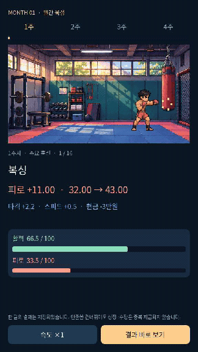
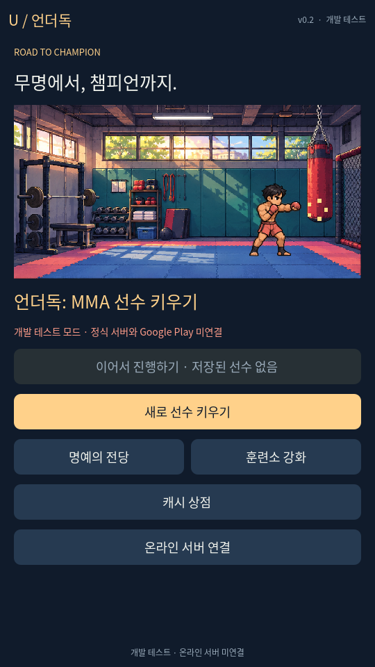
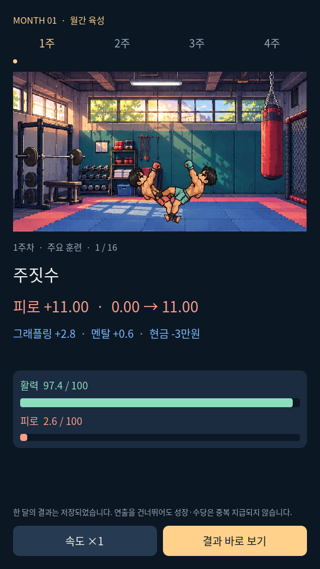
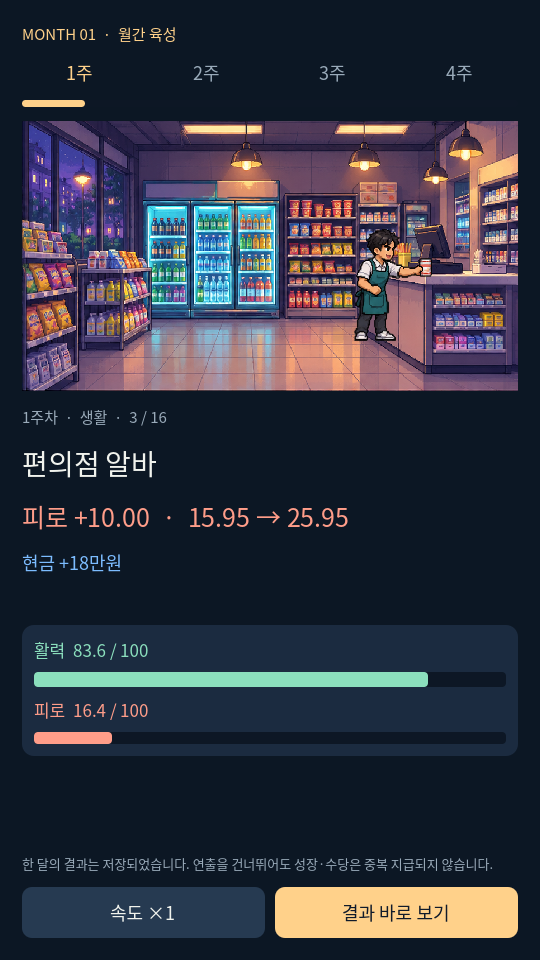
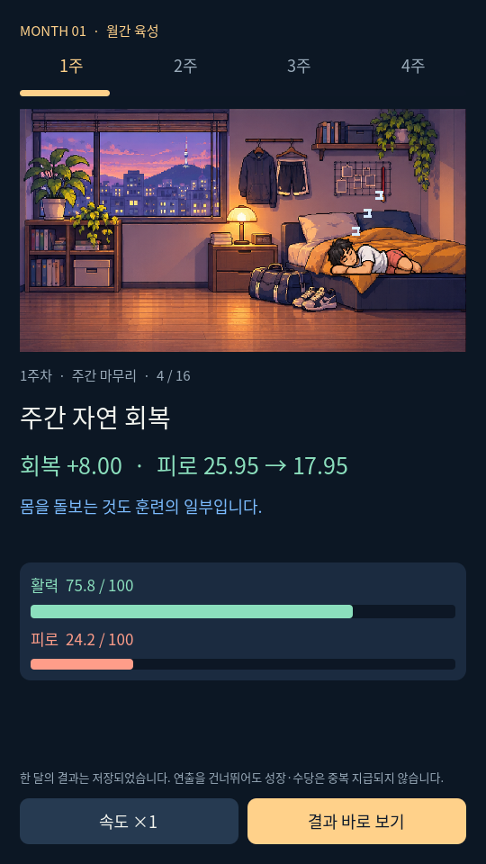

# 언더독: MMA 선수 키우기 — v0.2

**[Windows 게임 v0.2 다운로드 — 약 40MB](https://github.com/sunminkim87-dot/underdog-mma/raw/refs/heads/main/downloads/UNDERDOG_P0_v0.2_Windows.zip)**

[전체 Godot 프로젝트 v0.2 다운로드](https://github.com/sunminkim87-dot/underdog-mma/raw/refs/heads/main/downloads/UNDERDOG_P0_v0.2_Godot_Project.zip)

1. Windows ZIP을 다운로드하고 오른쪽 클릭 → **모두 압축 풀기**를 선택합니다.
2. 풀린 폴더의 **UNDERDOG_P0.exe**를 더블클릭합니다. Godot 설치는 필요 없습니다.
3. 자세한 안내는 같은 폴더의 **START_HERE.html**을 엽니다.

## 이번 수정

- 로비: 새 선수·이어하기·명예의 전당·훈련소·캐시 상점.
- 새 배경 4종과 캐릭터 애니메이션. 훈련·알바·회복을 장면과 움직이는 게이지로 표시.
- 4주 카드식 일정, 최대/실제 회복량과 피로 전후 표시.
- 경기 예정 월에는 월 진행을 차단하고 경기 후 재개.
- 유효 은퇴 기록·LP·시설 3종과 실제 성장 보너스·다음 선수에게 유지.
- 온라인 개발 서버와 실제 Godot HTTP 연동, 서버 권한 계산·계정 저장·중복 요청 방지.

## 현재 연결되지 않은 것

**운영 온라인 서버는 아직 배포하지 않았습니다.** 기본 Windows 실행은 명시적인 개발 테스트 모드입니다. 정식 게임의 방향은 온라인이며 서버 연결 기능과 서버 코드를 준비했습니다.

**Google Play 개발자 계정이 없어 실제 결제는 미연결입니다.** 캐시 상점 구매 버튼은 비활성화되어 있습니다. 실제 Google 영수증 검증 어댑터·Android Billing·영구 계정·기기 이전·운영 보안/성능 검증은 남아 있습니다.

Windows 실행 파일은 공식 템플릿으로 내보내기와 파일 형식을 검증했으나 Windows OS에서 직접 실행한 검증은 하지 않았습니다. 디지털 코드서명이 없으며 기존 보호 경고가 해결됐다고 보장하지 않습니다.

## 움직이는 미리보기



## 실제 화면

| 로비 | 월간 육성 |
|---|---|
|  |  |
|  |  |

## 문서

- [Windows 실행 안내](docs/WINDOWS_GUIDE.md)
- [구현/미구현](docs/STATUS.md)
- [테스트 결과](docs/TEST_REPORT.md)
- [온라인 개발 서버](server/README.md)
- [가정과 최신 변경](ASSUMPTIONS.md)
- [원본 기획서](docs/UNDERDOG_MMA_Game_Design_v1.3.md)
- [구조](docs/ARCHITECTURE.md)
- [참고한 공식 자료](docs/REFERENCE_NOTES.md)

## 개발자 검증

Godot 4.6.3 Standard에서 프로젝트를 가져온 뒤 실행합니다.

```sh
godot --headless --editor --path . --import --quit
godot --headless --path . --script res://tests/test_core.gd
godot --audio-driver Dummy --path . --script res://tests/test_ui.gd -- --ui-test
python -m unittest server.test_server -v
# 개발 서버를 localhost:8765에 실행한 상태에서 별도 테스트 userdata 사용:
godot --headless --path . --script res://tests/test_online.gd
```

[이전 v0.1 Windows ZIP](downloads/UNDERDOG_P0_Windows.zip)과 [이전 전체 프로젝트 ZIP](downloads/UNDERDOG_P0_Godot_Project.zip)은 삭제하지 않고 보존했습니다.
