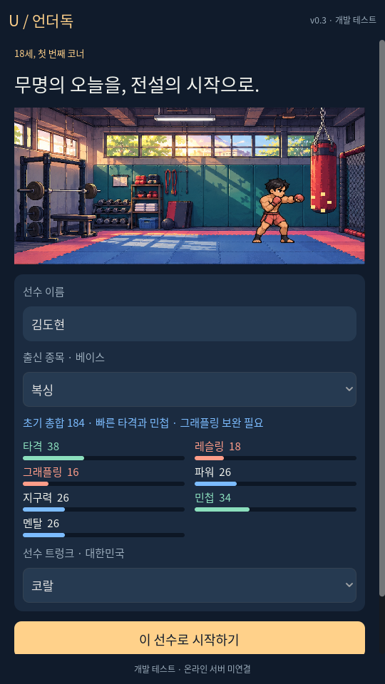
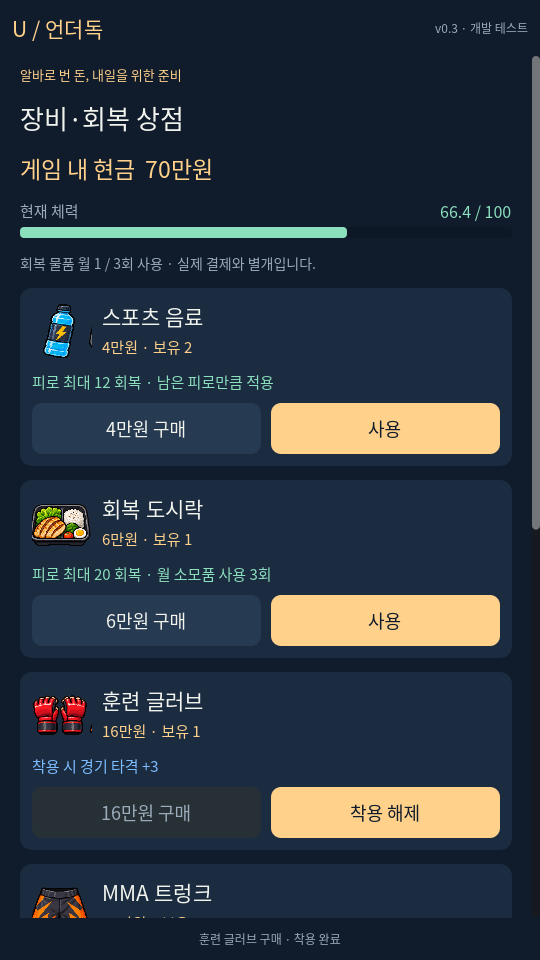
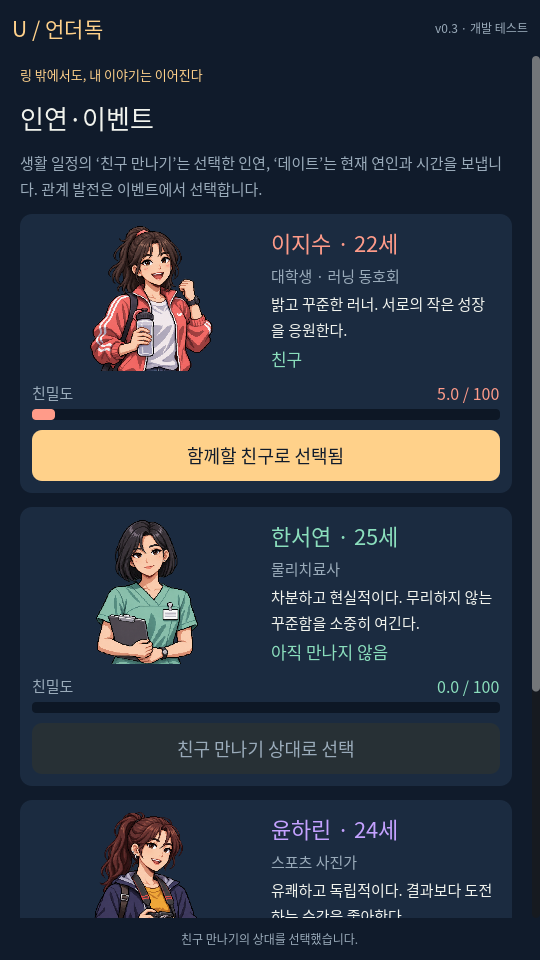
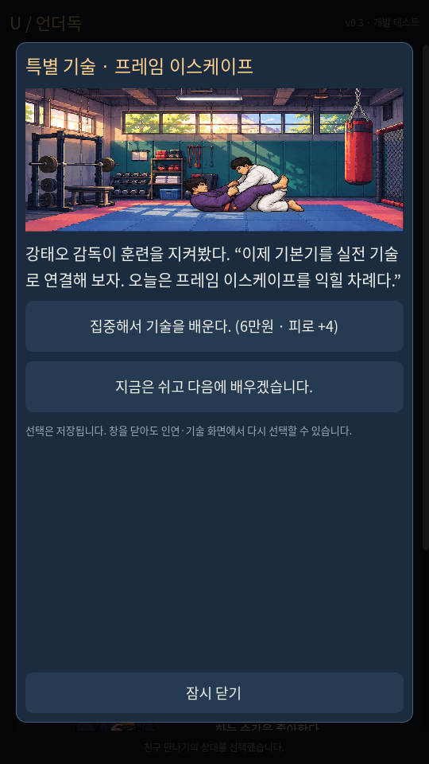
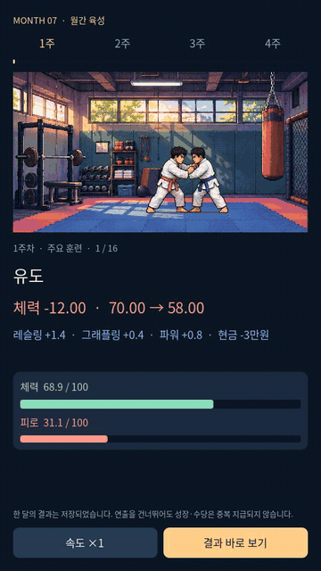

# 언더독: MMA 선수 키우기 — v0.3 초안

**[Windows 게임 v0.3 다운로드](https://github.com/sunminkim87-dot/underdog-mma/raw/refs/heads/main/downloads/UNDERDOG_P0_v0.3_Windows.zip)**

[전체 Godot 프로젝트 v0.3 다운로드](https://github.com/sunminkim87-dot/underdog-mma/raw/refs/heads/main/downloads/UNDERDOG_P0_v0.3_Godot_Project.zip)

1. Windows ZIP을 다운로드하고 오른쪽 클릭 → **모두 압축 풀기**를 선택합니다.
2. 풀린 폴더의 **UNDERDOG_P0.exe**를 더블클릭합니다. Godot 설치는 필요 없습니다.
3. 자세한 안내는 같은 폴더의 **START_HERE.html**을 엽니다.

## 이번에 플레이할 수 있는 내용

- 복싱·킥복싱·레슬링·유도·주짓수 출신 5종. 새 선수는 모두 **능력치 합계 184**, 종목별 강점과 약점이 다릅니다. 기존 선수의 능력치는 유지합니다.
- 색과 자세가 다른 종목 아이콘, 유도 던지기·레슬링 태클·주짓수 그라운드·킥복싱 애니메이션.
- 알바 7종: 편의점·배달·체육관 청소·창고·카페 + 이벤트로 여는 행사 보조·초보 지도. 수입과 피로가 다릅니다.
- 게임 내 현금 상점: 회복 물품 2종, 글러브·트렁크·마우스피스·러닝화. 실제 구입·보유·사용·착용과 경기 효과.
- 훈련·알바·휴식 장면과 **체력 소모/실제 회복량**, 움직이는 게이지.
- 이벤트 13종: 친구와 첫 만남, 연애 선택, 특별 기술 전수, 알바 제안. 등장인물 3명과 친밀도·친구 만나기·데이트.
- 특별 기술 5종: 해당 훈련 3회 + 공식 경기 1회 이후 이벤트로 배웁니다. 다른 베이스 기술도 배울 수 있습니다.
- 업적 6종과 최초 1회 물품 보상. 계정에 업적 기록이 유지됩니다.
- 경기일 월 진행 차단, MMA 자동 경기, 명예의 전당·LP·시설, 자동 저장/백업, 서버 권한 계산을 유지합니다.
- 서버 연결창 닫기 오류·온라인 자동 이어하기·손상된 회복 리포트 검증을 수정했습니다.

## 실제 화면

| 새 선수와 베이스 | 장비·회복 상점 |
|---|---|
|  |  |
|  |  |

## 아직 준비 중

대형 스킬트리, 긴 연애 이야기·추가 인물, 은퇴 선수 코치 전직·체육관 설립은 미구현입니다. 이번 초안은 **이벤트로 기술을 습득하는 방식**입니다. 초보 지도 알바와 은퇴 코치 기능은 별개입니다.

정식 방향은 온라인입니다. 개발 서버와 실제 HTTP 연동은 검증했지만 **운영 서버는 아직 배포하지 않았습니다.** 기본 실행은 화면에 표시된 개발 테스트 모드입니다. 연결했던 온라인 계정은 재실행 시 서버에서 이어가며, 실패했다고 자동으로 로컬 선수로 바꾸지 않습니다.

**Google Play 개발자 계정이 없어 실제 결제는 미연결이며 캐시 구매 버튼은 비활성화입니다.** 장비 상점은 알바로 번 게임 내 현금을 사용합니다.

Windows 공식 템플릿으로 내보냈지만 Windows OS 직접 실행·디지털 코드서명·Android 실기기 검증은 수행하지 못했습니다. 기존 Windows 보호 경고가 해결됐다고 보장하지 않습니다.

## 안내와 검증 자료

- [마우스 클릭부터 Windows 실행 안내](docs/WINDOWS_GUIDE.md)
- [구현/미구현](docs/STATUS.md) · [테스트 결과](docs/TEST_REPORT.md)
- [개발 서버](server/README.md) · [구조](docs/ARCHITECTURE.md)
- [수치와 초안 규칙](ASSUMPTIONS.md) · [원본 기획서](docs/UNDERDOG_MMA_Game_Design_v1.3.md)
- [참고 자료와 오리지널 아트](docs/REFERENCE_NOTES.md)

이전 파일을 보존했습니다: [v0.2 Windows](downloads/UNDERDOG_P0_v0.2_Windows.zip) · [v0.2 프로젝트](downloads/UNDERDOG_P0_v0.2_Godot_Project.zip) · [v0.1 Windows](downloads/UNDERDOG_P0_Windows.zip) · [v0.1 프로젝트](downloads/UNDERDOG_P0_Godot_Project.zip)
